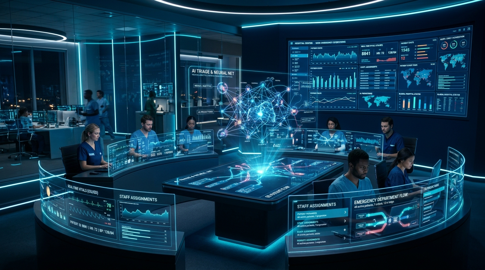

# CarePulse AI™ — Intelligent Clinical Triage & Emergency Flow Orchestration



[](https://opensource.org/licenses/MIT)
[](https://threejs.org/)
[](https://hl7.org/fhir/)
[](https://www.hhs.gov/hipaa)

> **Next-generation 3D clinical intelligence platform solving emergency department overcrowding, delayed triage, and clinician burnout.**

---

## 🌟 Overview & Societal Purpose

Overcrowded emergency departments cause avoidable diagnostic delays, patient fatalities, and unprecedented healthcare worker burnout worldwide. Over 4.2% of emergency patients leave without being seen (LWBS), and patients with occult sepsis or atypical STEMI wait hours while subtle vitals deteriorate unseen.

**CarePulse AI™** introduces:
1. **Interactive 3D Holographic Visualizer**: WebGL 3D Cardio Core, Neural Triage Brain, and Biometric DNA Helix with real-time mouse interaction and rhythmic 75 BPM telemetry animation.
2. **Dynamic AI Acuity Scoring (ESI 1-5 & MTS)**: Computes real-time Shock Index, SIRS criteria, and flags life threats within 3 seconds.
3. **Emergency Ward Bed Command Grid**: Interactive floor plan managing live beds, telemetry, ICU transfers, and sanitization cycles.
4. **Ambient Voice SBAR Documentation**: Hands-free acoustic AI transcribing doctor-patient bedside exams directly into FHIR-ready clinical notes.
5. **Hospital Financial ROI Calculator**: Interactive modeling showing $3.2M+ annual savings and < 4 months payback period.

---

## 📂 Web Application Structure

The platform includes all 5 required pages:

- **[Home Page](index.html)**: Interactive 3D hero stage, real-time emergency ticker, societal crisis breakdown, 4-step workflow, and core capability pillars.
- **[About You Page](about.html)**: Founder & Architect profile for **Waqas Ali**, personal catalyst, technical competencies, and ethical AI pledge.
- **[Application Prototype Informational Page](prototype.html)**: Hands-on interactive clinical prototype with preset testing cases, live bed command grid, ambient voice simulation, and surge capacity models.
- **[Marketing Page](marketing.html)**: Economic value proposition, interactive hospital ROI calculator, competitive matrix against Epic/Cerner, and transparent SaaS pricing tiers.
- **[User Guide Page](user-guide.html)**: Role-based clinical standard operating procedures (SOP), interactive troubleshooting assistant, searchable FAQ, and HL7 FHIR REST API reference.

---

## 🚀 Live Deployment & How to Run

### Local Execution:
```bash
# Start a local web server
python -m http.server 8080
# Visit in your browser:
# http://localhost:8080/
```

### Vercel Deployment:
Deploy directly with the Vercel CLI or via GitHub integration:
```bash
npx vercel --prod
```

---

## 👨‍💻 Author & Systems Architect

**Waqas Ali**  
*Lead Biomedical Informatics & Software Systems Architect*  
GitHub: [@waqas760000-source](https://github.com/waqas760000-source)

---

## 📄 License
CarePulse AI is licensed under the [MIT License](LICENSE).
